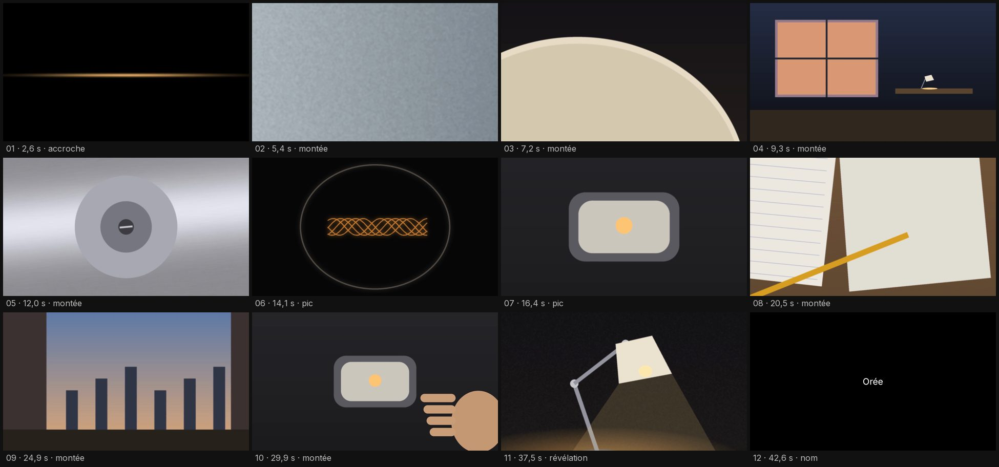

<a href="https://github.com/sebmake/sebmake-videoedit-like-applepls/releases/latest">

</a>

# sebmake-videoedit-like-applepls

For anyone who edits: it cuts your footage the way Apple cuts the films it shows during its keynotes, or reviews an edit you've already made and tells you what to fix, usually down to the timecode.

It builds the timeline in FilmCraft, an editing app it drives directly, or hands you an FCP7 XML file for DaVinci Resolve and Premiere Pro, with an EDL (edit decision list) as a fallback.

The rules come from the films of eight Apple keynotes, 2019 to 2026, broken down shot by shot and counted: 16 product films, 20 opening and mood films, 8 documentaries, 6 trailers and 2 films that show people using a product. Every rule carries its count ("N out of M"). Anything that wasn't measured is labeled a convention.

The skill's instructions are in French.

[Watch the two test films in the latest release](https://github.com/sebmake/sebmake-videoedit-like-applepls/releases/latest)

## Install

```bash
npx skills@latest add sebmake/sebmake-videoedit-like-applepls
```

It's one of the four [LikeApplePLS](https://github.com/sebmake/skills) skills, and `npx skills@latest add sebmake/skills/LikeApplePLS` installs all of them.

Or as a Claude Code plugin:

```bash
claude plugin marketplace add sebmake/sebmake-videoedit-like-applepls
claude plugin install sebmake-videoedit-like-applepls@sebmake-videoedit
```

You'll need Python 3.9 or later, with ffmpeg and ffprobe on your PATH. Footage analysis and the review also need numpy and Pillow, which the skill looks for in `~/.venv-videoedit`:

```bash
python3 -m venv ~/.venv-videoedit && ~/.venv-videoedit/bin/pip install numpy pillow
```

For Premiere Pro and DaVinci Resolve, you just import the file. For FilmCraft, Claude Code has to run on the same machine as the app. If FilmCraft is already open without its control port, quit it and relaunch it with `open -a FilmCraft --args --control 9876`; the skill never closes your project.

## Why use it?

Common editing habits don't match what these films do.

Music doesn't drive the cuts: in the documentaries, 363 of 597 cuts land on a sound onset, about what chance would give. Dissolves are rare: the documentaries have 594 straight cuts out of 606 shot changes. No product film shows a number or ends on a slogan or a logo alone (0 out of 16).

The reveal comes late, at almost the same point every time. In the 10 films that save the product for the end, it shows up in full between 69% and 82% of the running time, never in the first shot. Trailers speed up as they go: their median shot gets shorter with each third of the film (1.20 s, then 0.90 s, then 0.77 s).

The skill asks what you have (footage, music, an existing edit), the kind of film, its length, its format and your editing app. A script splits each clip into takes and flags blur, shake, black and overexposed frames, using fixed thresholds that can be wrong; Claude looks at thumbnails and notes what each take shows. Before building anything, you see the film as a table, one row per shot, with the rule each shot follows.

The review reads a video, an FCP7 XML or an EDL and compares the edit to the films of its kind. Each issue comes with its rule, its count in the films, and most of the time a fix like "replace the dissolve at 00:00:18:13 with a cut."

It won't make up a name, a job title, a number or a quote. Music is yours to supply; without it, the film has none. Nothing from Apple ends up in your film.

## Reference

- **[SKILL.md](./skills/sebmake-videoedit-like-applepls/SKILL.md)** — The main skill: the questions, the shot-by-shot plan, then the build, the export or the review.
- **[grammaire-montage.md](./skills/sebmake-videoedit-like-applepls/references/grammaire-montage.md)** — How each kind of film is cut: shape, pacing, cuts, black, the reveal, text.
- **[critique.md](./skills/sebmake-videoedit-like-applepls/references/critique.md)** — How to run the review, read its report and turn an alert into an edit.
- **[logiciels.md](./skills/sebmake-videoedit-like-applepls/references/logiciels.md)** — FilmCraft, Premiere Pro and DaVinci Resolve: building, importing, and reading a timeline back.
- **[montage-spec.md](./skills/sebmake-videoedit-like-applepls/references/montage-spec.md)** — The `rushes.json` and `montage.json` formats.

The reference files are in French.

On 46 of the source films, the review raised no alert on 42, though almost all still got a note to check by eye. On an edit made badly on purpose, it raised 4 alerts from the XML alone and 9 with Claude's notes; neither test proves it catches every mistake. Nobody has opened its files in Premiere Pro or DaVinci Resolve yet. They've been checked by the export itself, by a second script and by FilmCraft's importer.

A video on its own tells the review less than a timeline does. On the test renders, it missed a cut between two similar dark shots and didn't catch a single fade to or from black. Whether it reads a video or an XML file, it takes zooms and rotations for static shots. Vertical and square formats reuse the 16:9 rules, since none of the source films is vertical or square, and no export reframes the shots.

---

Not affiliated with, endorsed or sponsored by Apple Inc. Apple, Keynote and Final Cut Pro are trademarks of Apple Inc. DaVinci Resolve is a trademark of Blackmagic Design. Premiere Pro is a trademark of Adobe. MIT License.
